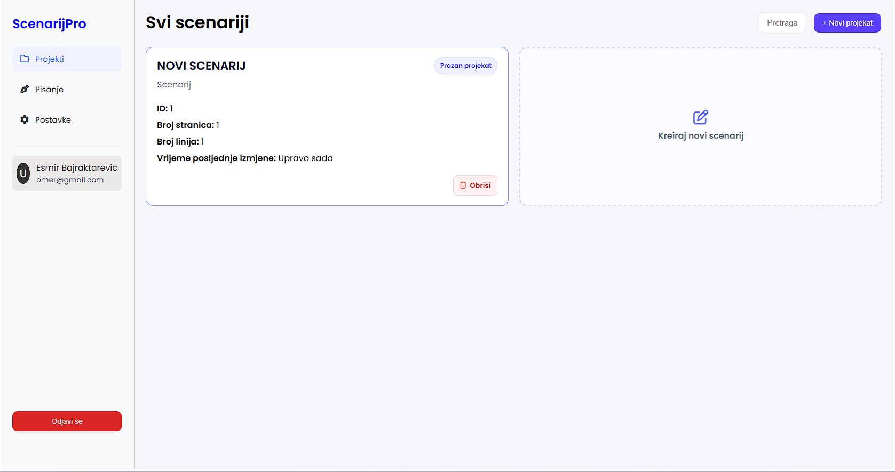
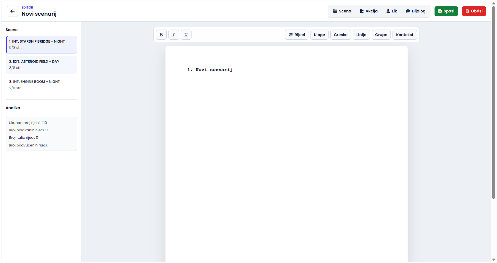

# 🎬 ScenarijPro

**ScenarijPro** is a web-based screenplay writing and project management application designed for writers to create, edit, and track screenplay drafts with real-time change monitoring.

The application allows users to manage multiple writing projects, edit scenes, track text changes, and organize screenplay elements such as scenes, dialogue, and characters.

The core system logic is implemented inside **`writing.html`**, where API routes and database communication are defined for tracking writing activity and document changes.

---

## ✨ Features

### 📂 Project Management
- Create and manage screenplay projects
- Track project status and drafts
- Display screenplay metadata (pages, last modification time)

### ✍️ Screenplay Editor
- Scene-based writing interface
- Dialogue and action formatting
- Character renaming
- Text styling:
  - Bold
  - Italic
  - Underline

### 📊 Change Tracking System
- Word count tracking
- Formatting statistics
- Periodic change synchronization
- Writing activity monitoring

### 👤 User Account Settings
- Profile management
- Security settings
- Two-Factor Authentication (2FA)
- Notification preferences

---

## 🧠 Core Component — `writing.html`

The **main logic of the application** is implemented in:
writing.html


This file handles:

- API communication
- Scene editing logic
- Change tracking
- Character updates
- Database synchronization

### Responsibilities

- Defines API routes used by the editor
- Sends writing updates to backend services
- Tracks user edits in real time
- Communicates with MySQL database

---

## 🗄️ Database (MySQL)

The application uses a **MySQL database** to store:

- Users
- Projects
- Scenes
- Characters
- Text changes
- Writing statistics

Change tracking allows monitoring of:

- word counts
- formatting usage
- editing history

---

## 🔌 API Routes

The editor communicates with backend endpoints responsible for:

- loading scenes
- saving updates
- renaming characters
- syncing changes
- retrieving statistics

Example operations:

- `LOAD scene`
- `CREATE scene`
- `UPDATE content`
- `RENAME character`

---

## 🛠️ Technologies Used

- HTML5
- CSS3
- JavaScript
- MySQL
- REST API architecture

---

## Configuration

The app does not use a `.env` file. Runtime and database settings are hardcoded in:

```text
config/app-config.js
```

Local MySQL settings:

```js
name: "scenarijpro"
user: "root"
password: ""
host: "localhost"
port: 3306
dialect: "mysql"
```

Docker MySQL settings are also hardcoded in the same file. When the app runs inside Docker it uses the Compose service name `db`:

```js
name: "scenarijpro"
user: "scenarijpro"
password: "scenarijpro_password"
host: "db"
port: 3306
dialect: "mysql"
```

The server listens on port `3000`. Database sync mode is controlled by `dbSync` in `config/app-config.js`; the default is `"alter"` so a fresh MySQL container gets the required tables automatically.

### Start command

```bash
npm ci
npm start
```

The app serves static pages from `public/` and exposes the main page at:

```text
/html/projects.html
```

### Health check

```text
/health
```

### Platform notes

- Docker deployments can use the included `Dockerfile` and `docker-compose.yml`.
- `docker-compose.yml` starts both containers required by the ARM task: the web app and a MySQL DB container.
- The app does not require `.env`; database values are hardcoded in `config/app-config.js`.

### Docker start

```bash
docker compose up -d --build
```

Stop containers:

```bash
docker compose down
```

### GitHub Actions deployment

The repository includes `.github/workflows/deploy.yml`.

On push to `main` or `master`, GitHub Actions:

- installs dependencies and runs `npm test`
- validates `docker-compose.yml`
- builds the Docker image
- uploads the repository to the EC2 instance over SSH
- runs `docker compose up -d --build` on the EC2 instance

Required GitHub repository secrets:

```text
EC2_HOST      Public IP or DNS name of the EC2 instance
EC2_USER      SSH user, usually ubuntu
EC2_SSH_KEY   Private SSH key for the EC2 instance
EC2_PORT      Optional, defaults to 22
```

The EC2 instance must already have Docker with the Compose plugin installed.

### Apache virtual host

Template configuration is in:

```text
deploy/apache/scenarijpro.conf
```

Replace `scenarijpro.arm.com` with the selected project domain, copy the file to Apache sites, enable required modules, then reload Apache:

```bash
sudo cp deploy/apache/scenarijpro.conf /etc/apache2/sites-available/scenarijpro.conf
sudo a2enmod proxy proxy_http ssl headers
sudo a2ensite scenarijpro.conf
sudo systemctl reload apache2
```

Place the SSL certificate and key at:

```text
/etc/ssl/certs/scenarijpro.crt
/etc/ssl/private/scenarijpro.key
```

---

## 📸 Screenshots

<p align="center">
  
  
  
</p>

---

